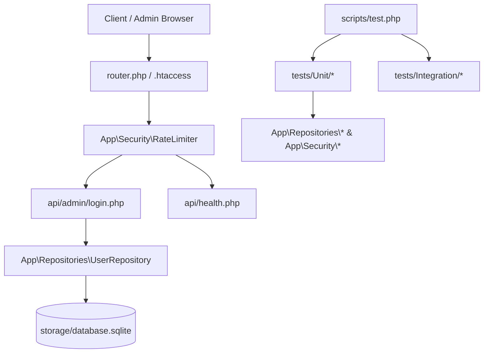

# upScale Platform - System Modernization & Improvement Spec

**Date:** 2026-10-02  
**Status:** Approved  
**Author:** Pair Programming Agent & Isaias  
**Scope:** Architecture, Security, UI/UX, Automated Testing (TDD), and Reliability  

---

## 1. Context & Objectives

The **upScale** system is a multi-tenant platform for ticket/raffle campaigns, post-pix upsell funnels, and partner whitelabels.
The objective of this modernization is to elevate the platform to enterprise standards of reliability, security, and developer experience locally, focusing on:
1. **Security & Brute-Force Defense:** Rate limiting on admin logins, active session verification, and structured health telemetry.
2. **User & Workspace Administration:** Unified management of users and memberships via clean API endpoints and dashboard UI.
3. **Automated Testing & TDD:** A built-in testing framework and test suites covering core business logic (splits, orders, rate limits, schema validation).
4. **UI/UX Quality (UI/UX Pro Max):** Eliminating raw emojis, implementing accessible SVG icons, WCAG 4.5:1 contrast, 44x44px touch targets, and resilient responsive design.

---

## 2. Architecture & Components

### Component Details

1. **`App\Security\RateLimiter` (`src/Security/RateLimiter.php`)**
   - Tracks attempts per IP/key in `storage/cache/rate_limits.json` or SQLite table.
   - Threshold: Max 5 failed attempts per 15-minute window for login.
   - Methods: `hit(string $key): void`, `isTooManyAttempts(string $key, int $maxAttempts, int $decaySeconds): bool`, `clear(string $key): void`, `availableIn(string $key, int $decaySeconds): int`.

2. **Health & Telemetry Endpoint (`api/health.php`)**
   - Responds with JSON:
     - `status`: "ok" | "degraded" | "error"
     - `database`: connection latency and writable check
     - `disk_space`: free space percentage
     - `php_version`: PHP version and active extensions (pdo, pdo_sqlite, pdo_mysql)
     - `timestamp`: UTC ISO8601

3. **User Management API (`api/admin/users.php`)**
   - Exposes RESTful CRUD actions protected by `AdminAuth`:
     - `GET`: List users in workspace.
     - `POST`: Create or update user + membership role.
     - `DELETE`: Revoke membership.

4. **Testing Suite & Runner (`scripts/test.php` & `tests/`)**
   - Lightweight, standalone PHP test harness requiring zero external Composer dependencies.
   - Covers:
     - `tests/Unit/RateLimiterTest.php`
     - `tests/Unit/PartnerSplitRuleTest.php`
     - `tests/Integration/HealthEndpointTest.php`
     - `tests/Integration/DatabaseIntegrityTest.php`

5. **UI/UX Pro Max Polish (`index.html` & `embed-rifa.html`)**
   - Data-dense design system tokens (Indigo `#1E40AF`, Slate `#F8FAFC`, Amber `#D97706`).
   - SVG icon definitions replacing unstyled emoji glyphs.
   - Minimum 44px touch targets on buttons and mobile modal close triggers.

---

## 3. Verification & Acceptance Criteria
- Running `php scripts/test.php` passes all test cases with green indicators and exit code 0.
- `GET /api/health.php` returns HTTP 200 with complete diagnostics.
- Attempting 5 invalid logins triggers HTTP 429 Too Many Requests with retry-after header.
- UI elements adhere to WCAG 4.5:1 contrast and SVG icon standards.
